# Sistema de Gestión de Trabajos de Grado — FIET

> Plataforma de microservicios que digitaliza el ciclo de vida de los trabajos de grado en la FIET (Universidad del Cauca): desde la presentación del **Formato A** hasta la **evaluación del anteproyecto**.

**🇪🇸 Español:** cliente de escritorio JavaFX + 7 microservicios de negocio Spring Boot (auth, usuarios, Formato A, coordinación, anteproyecto, evaluación y notificaciones), un API Gateway y Eureka para descubrimiento. PostgreSQL por servicio, mensajería asíncrona con RabbitMQ, autenticación JWT y Resilience4j. Todo se levanta con Docker Compose.

**🇺🇸 English summary:** A microservices platform for managing graduate projects at Universidad del Cauca. It combines a JavaFX desktop client with Spring Boot services behind an API Gateway, per-service PostgreSQL databases, RabbitMQ event-driven notifications, JWT authentication and Resilience4j circuit breakers. The whole stack runs with a single `docker compose up`.

---

<div align="center">


[Capturas](#-capturas-de-la-aplicación) •
[Arquitectura](#-arquitectura) •
[Cómo ejecutar](#-ejecución-local) •
[API](#-api-y-documentación) •
[Equipo](#-equipo)

</div>

---

## 📸 Capturas de la aplicación

Todas las capturas fueron tomadas ejecutando el sistema completo en local (PostgreSQL + microservicios + cliente JavaFX).

<table>
  <tr>
    <td width="50%">
      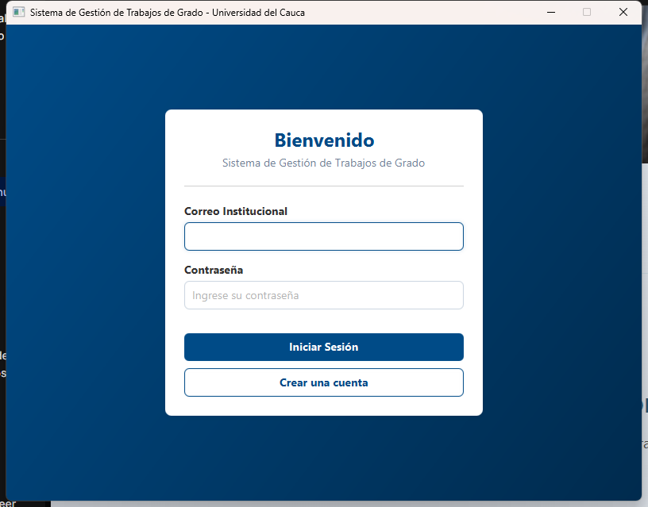
      <p align="center"><b>Inicio de sesión</b><br/>Autenticación con correo institucional</p>
    </td>
    <td width="50%">
      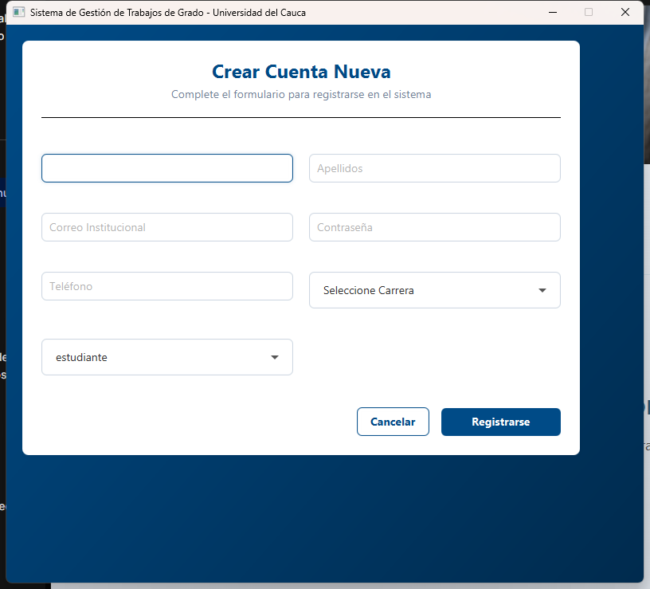
      <p align="center"><b>Registro de usuarios</b><br/>Selección de carrera y rol</p>
    </td>
  </tr>
  <tr>
    <td width="50%">
      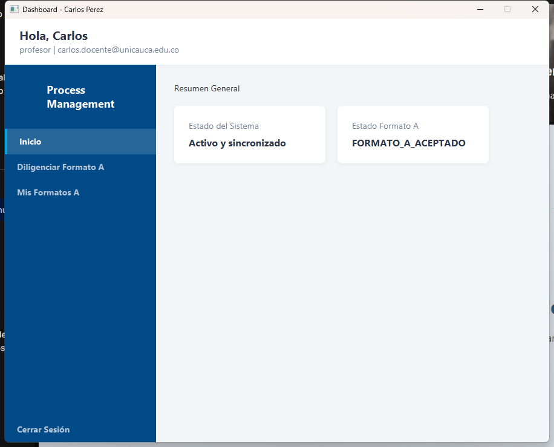
      <p align="center"><b>Dashboard del docente</b><br/>Estado del Formato A y accesos rápidos</p>
    </td>
    <td width="50%">
      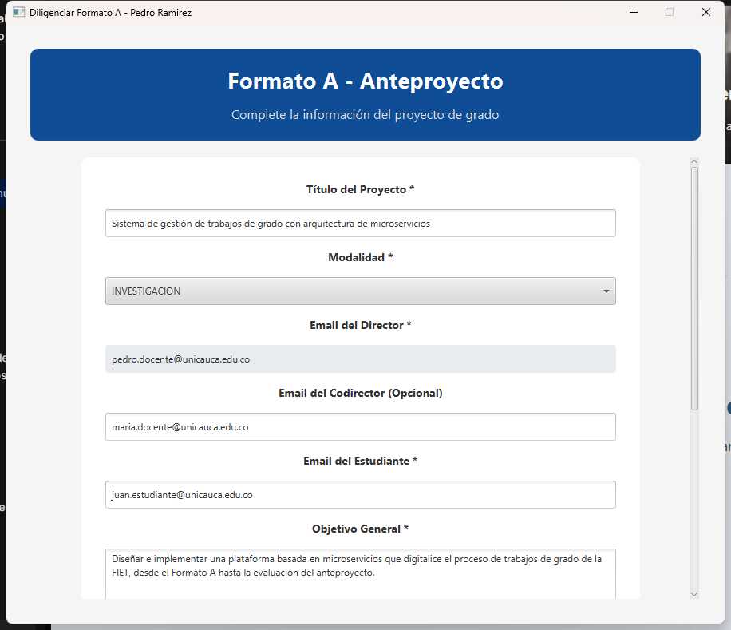
      <p align="center"><b>Formulario Formato A</b><br/>Datos del proyecto, objetivos y adjuntos</p>
    </td>
  </tr>
  <tr>
    <td width="50%">
      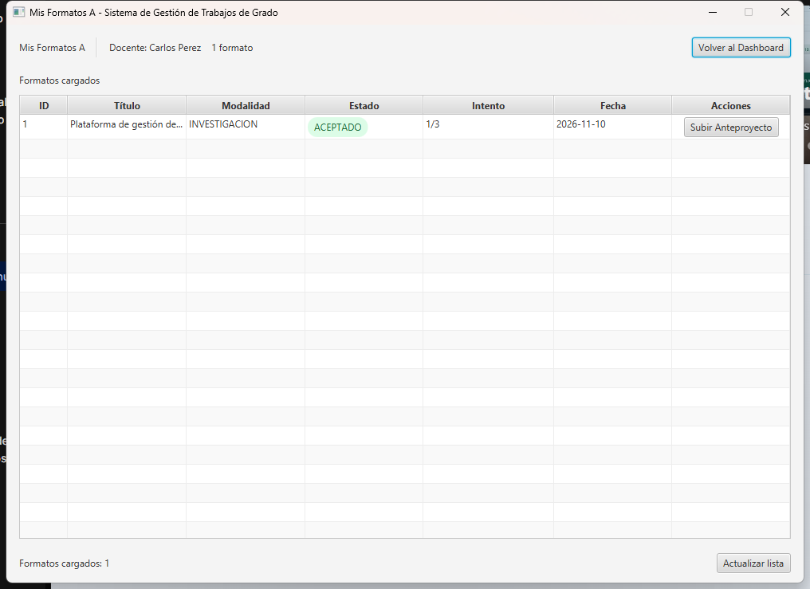
      <p align="center"><b>Mis Formatos A</b><br/>Historial, estado e intentos del docente</p>
    </td>
    <td width="50%">
      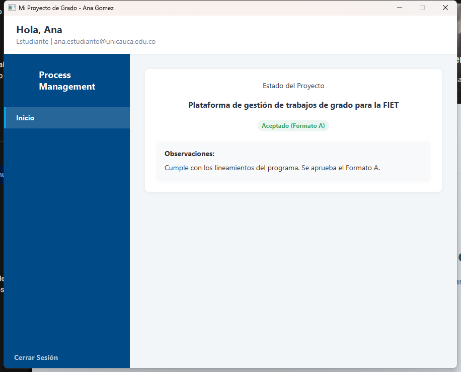
      <p align="center"><b>Vista del estudiante</b><br/>Estado del proyecto y observaciones</p>
    </td>
  </tr>
  <tr>
    <td width="50%">
      
      <p align="center"><b>Dashboard del coordinador</b><br/>Formatos pendientes de aprobación o rechazo</p>
    </td>
    <td width="50%">
      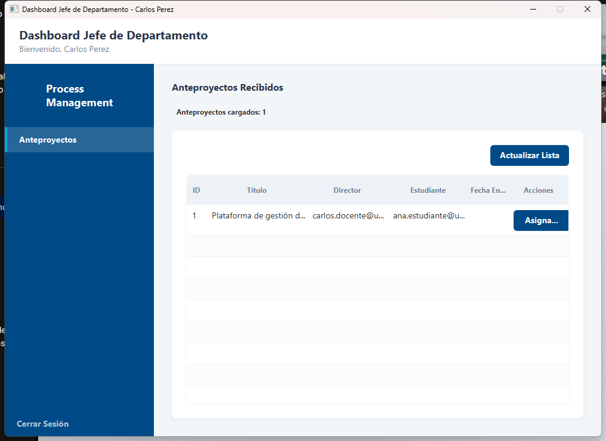
      <p align="center"><b>Jefe de departamento</b><br/>Anteproyectos recibidos y asignación de evaluadores</p>
    </td>
  </tr>
  <tr>
    <td width="50%">
      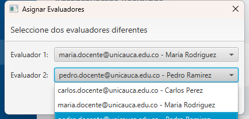
      <p align="center"><b>Asignación de evaluadores</b><br/>Selección de dos docentes del departamento</p>
    </td>
    <td width="50%">
      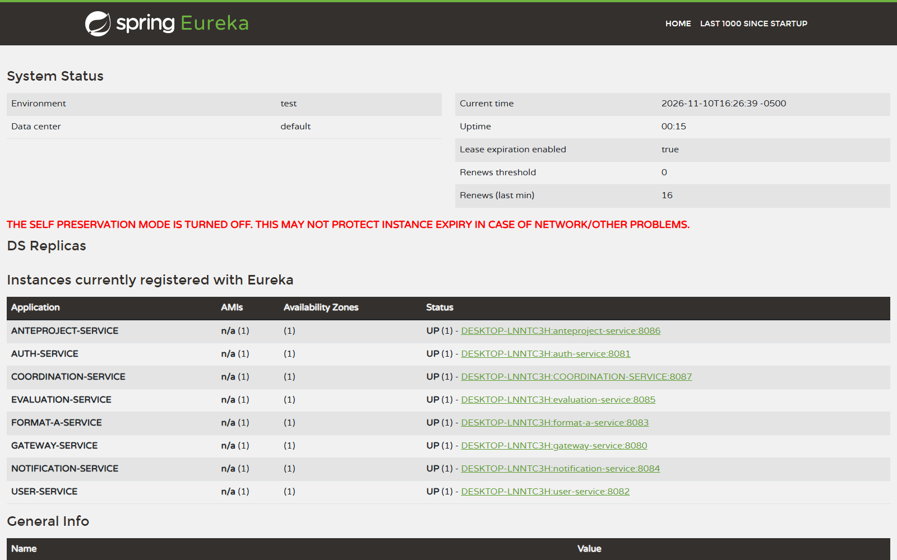
      <p align="center"><b>Service discovery</b><br/>Servicios registrados en Eureka</p>
    </td>
  </tr>
  <tr>
    <td colspan="2" align="center">
      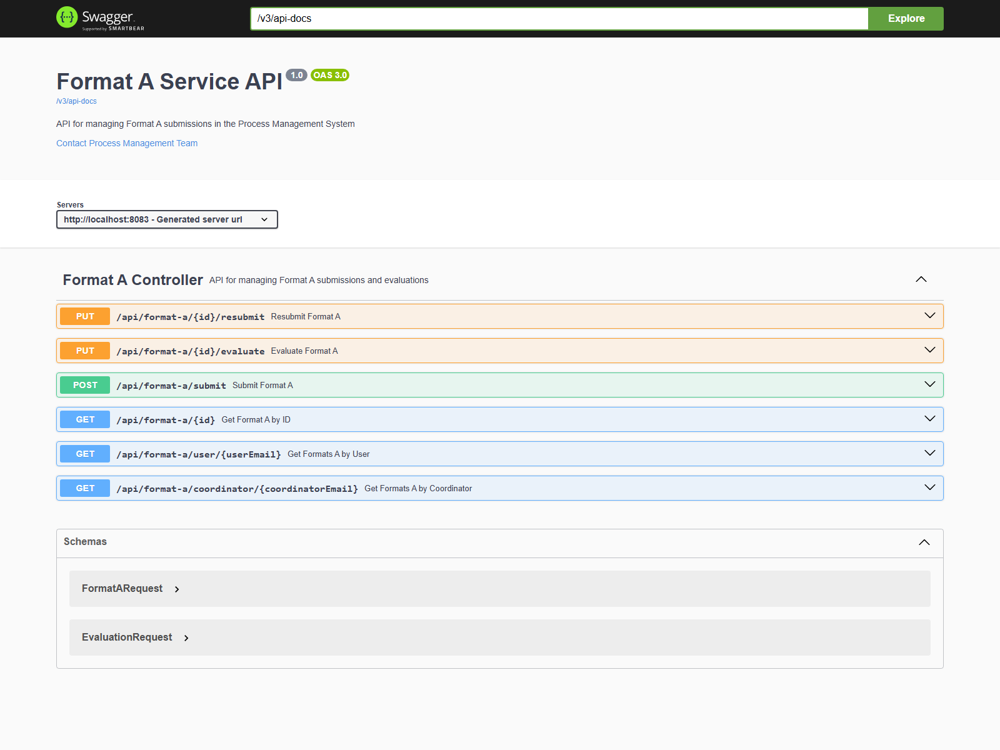
      <p align="center"><b>Documentación OpenAPI</b><br/>Swagger UI de <code>format-a-service</code></p>
    </td>
  </tr>
</table>

> Las capturas se pueden regenerar ejecutando el sistema localmente; ver [Ejecución local](#-ejecución-local).

---

## 📋 Descripción

El sistema reemplaza el trámite manual de trabajos de grado de la FIET con un flujo digital trazable. Cada actor ve únicamente lo que le corresponde y cada cambio de estado dispara notificaciones automáticas.

**Objetivos**

- Digitalizar el proceso de Formato A y anteproyecto.
- Automatizar notificaciones y aprobaciones.
- Centralizar la información de proyectos, docentes y estudiantes.
- Garantizar trazabilidad de intentos, observaciones y evaluadores.

### Funcionalidades por rol

| Rol | Qué puede hacer |
|---|---|
| **Docente** | Registrarse, diligenciar el Formato A, reenviarlo (máx. 3 intentos), subir el anteproyecto y consultar su estado. |
| **Estudiante** | Consultar el estado de su proyecto y las observaciones de la evaluación. |
| **Coordinador** | Ver formatos pendientes, aprobar o rechazar con observaciones, consultar proyectos y reportes. |
| **Jefe de departamento** | Ver anteproyectos enviados y asignar dos evaluadores docentes. |
| **Docente evaluador** | Es asignado a un anteproyecto; las asignaciones y evaluaciones se gestionan en `evaluation-service`. |

### Flujo del proceso

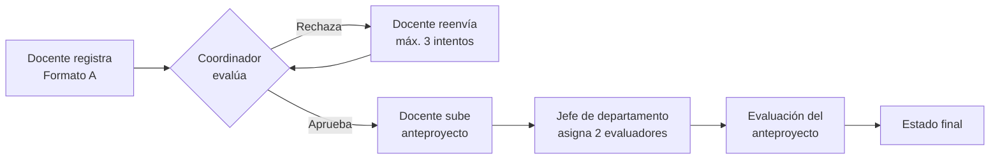

---

## 🏗️ Arquitectura

El sistema sigue una **arquitectura de microservicios** con un gateway como único punto de entrada, descubrimiento de servicios con Eureka y comunicación asíncrona mediante RabbitMQ.

### Diagrama de contenedores (C4)

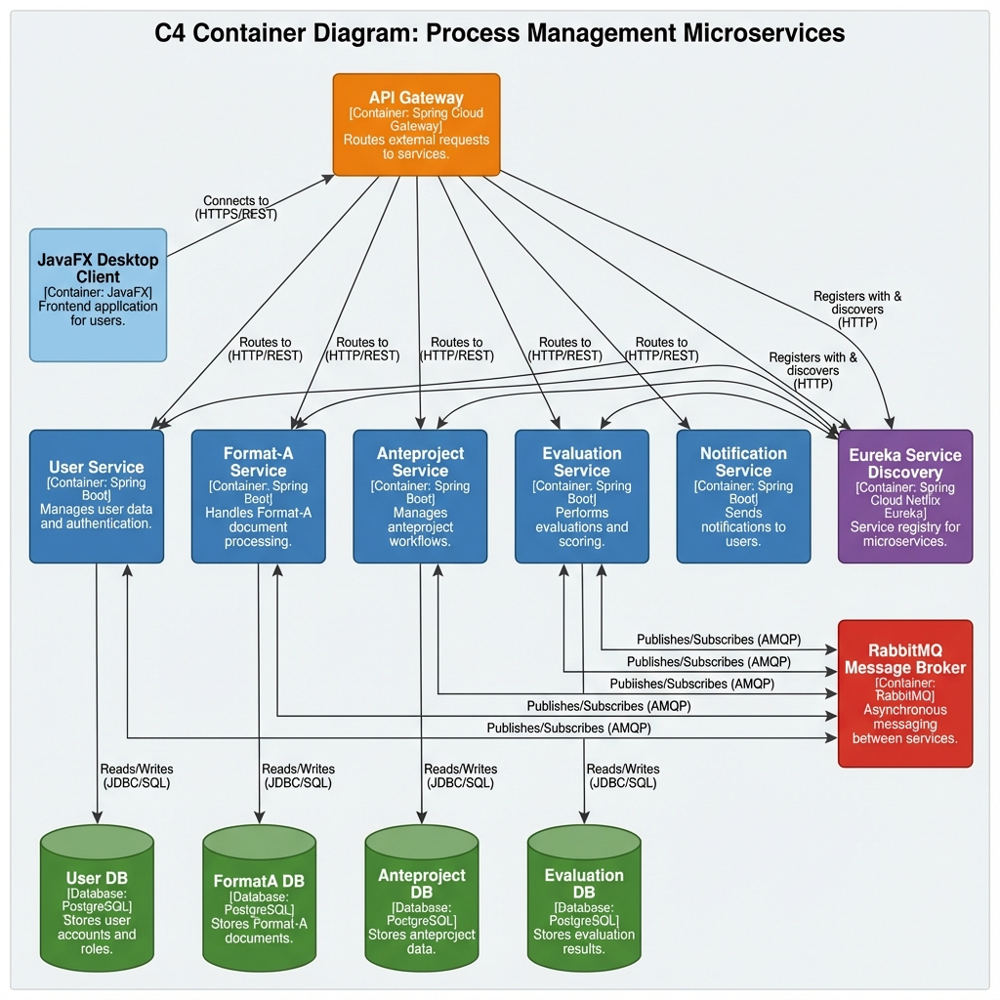

### Vista general

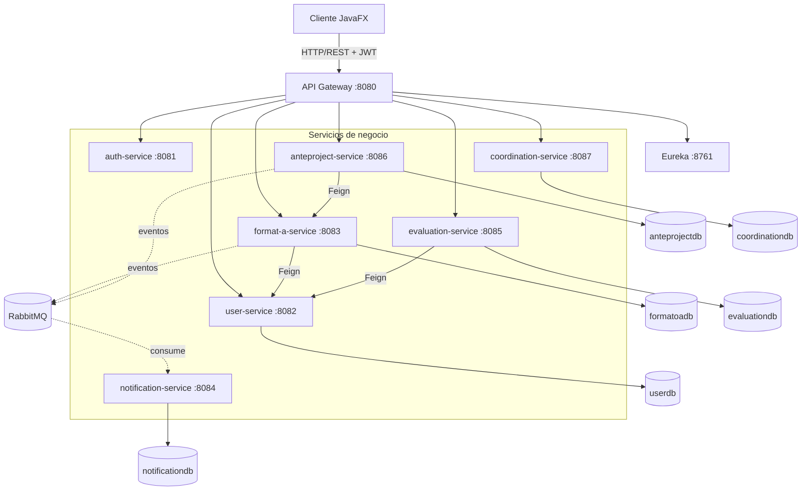

### Servicios y puertos

| Servicio | Puerto | Responsabilidad |
|---|---:|---|
| **gateway-service** | 8080 | Punto único de entrada, validación JWT, CORS y enrutamiento |
| **auth-service** | 8081 | Login y generación de tokens JWT |
| **user-service** | 8082 | Registro y consulta de usuarios, jefes de departamento |
| **format-a-service** | 8083 | Ciclo de vida del Formato A, reintentos y Swagger |
| **notification-service** | 8084 | Consumo de eventos y envío de correos |
| **evaluation-service** | 8085 | Asignación y gestión de evaluadores |
| **anteproject-service** | 8086 | Anteproyectos con arquitectura hexagonal |
| **coordination-service** | 8087 | Dashboard, proyectos y reportes del coordinador |
| **discovery-service** | 8761 | Registro y descubrimiento (Eureka) |
| **PostgreSQL** | 5432 | Una base de datos por microservicio |
| **RabbitMQ** | 5672 / 15672 | Mensajería asíncrona y consola de administración |

> Los puertos coinciden con `docker-compose.yml` y con el `server.port` de cada servicio.

### Otros diagramas

| Diagrama | Archivo |
|---|---|
| Contexto | [`docs/diagrams/context_diagram.png`](docs/diagrams/context_diagram.png) |
| Componentes | [`docs/diagrams/component_diagram.png`](docs/diagrams/component_diagram.png) |
| Contextos delimitados | [`docs/diagrams/bounded_context_diagram.png`](docs/diagrams/bounded_context_diagram.png) |
| Flujo de eventos | [`docs/diagrams/event_flow.png`](docs/diagrams/event_flow.png) |
| Secuencia del Formato A | [`docs/diagrams/sequence_formata.png`](docs/diagrams/sequence_formata.png) |

Documentación ampliada: [`docs/ARCHITECTURE.md`](docs/ARCHITECTURE.md) y [`docs/INDEX.md`](docs/INDEX.md).

---

## 🧰 Stack tecnológico

| Capa | Tecnología |
|---|---|
| Cliente | JavaFX 21, Jackson, CSS |
| Backend | Java 17+, Spring Boot 3.2.0, Spring Cloud 2023.0.0 |
| Persistencia | Spring Data JPA + PostgreSQL 15 |
| Mensajería | Spring AMQP + RabbitMQ 3.11 |
| Seguridad | JWT (JJWT 0.11.5), validación en el gateway |
| Resiliencia | Resilience4j (circuit breaker) |
| Documentación | Swagger / OpenAPI 3 (springdoc) |
| Build | Maven |
| Infraestructura | Docker + Docker Compose |

---

## 📂 Estructura del repositorio

```
ProcessManagement/
├── docker-compose.yml
├── docker-entrypoint-initdb.d/       # Creación de las 6 bases de datos
├── docs/                             # Arquitectura, pruebas, diagramas y capturas
│   ├── diagrams/
│   └── screenshots/
├── storage/                          # Archivos subidos (PDF, cartas)
└── ProccesManagementMicroservices/
    ├── discovery-service/
    ├── gateway-service/
    ├── auth-service/
    ├── user-service/
    ├── format-a-service/
    ├── coordination-service/
    ├── anteproject-service/
    ├── evaluation-service/
    ├── notification-service/
    └── presentation/                 # Cliente JavaFX
```

---

## 🚀 Ejecución local

### Requisitos

- **Docker Desktop** (con Docker Compose v2)
- **Java 17 o superior**
- **Maven 3.9+**

### 1. Clonar el repositorio

```bash
git clone https://github.com/Julianste15/ProcessManagement.git
cd ProcessManagement
```

### 2. Levantar el backend

```bash
docker compose up -d --build
```

Esto construye y arranca PostgreSQL, RabbitMQ, Eureka, el gateway y los siete microservicios.

**Verificar que todo esté arriba:**

- Eureka: <http://localhost:8761>
- Gateway: <http://localhost:8080>
- RabbitMQ: <http://localhost:15672> (`guest` / `guest`)
- Swagger de Formato A: <http://localhost:8083/swagger-ui/index.html>

> El primer arranque tarda varios minutos porque Maven descarga dependencias y se construyen nueve imágenes. Los servicios aparecen en Eureka a medida que terminan de iniciar.

### 3. Ejecutar el cliente de escritorio

En otra terminal:

```bash
cd ProccesManagementMicroservices/presentation
mvn javafx:run
```

También puedes usar los scripts incluidos en `presentation/`:

```powershell
.\run-javafx.ps1
# o, si tienes problemas con el module-path:
.\run-javafx-simple.ps1
```

### 4. Crear usuarios

El sistema **no incluye usuarios precargados**: el primer usuario se crea desde la pantalla **“Crear una cuenta”** del cliente. El registro permite elegir rol (estudiante, profesor o coordinador) y carrera.

Recomendación para probar el flujo completo:

1. Registra un **docente** y diligencia un Formato A.
2. Registra un **coordinador** y aprueba el Formato A.
3. Vuelve al docente y sube el anteproyecto.
4. Registra dos **docentes** más como evaluadores.
5. Como coordinador, asigna a un docente como jefe de departamento y entra con esa cuenta para asignar evaluadores.

### Notas de configuración

- `notification-service` usa SMTP de Gmail. Sin una contraseña de aplicación válida (`EMAIL_PASSWORD`), los correos no se envían, pero el resto del sistema funciona con normalidad.
- Cada microservicio usa su propia base de datos; `docker-entrypoint-initdb.d/init.sql` las crea en el primer arranque.
- Para reiniciar desde cero (borra datos): `docker compose down -v`.

### Comandos útiles

```bash
docker compose ps                  # estado de los contenedores
docker compose logs -f             # logs de todos los servicios
docker compose logs -f user-service
docker compose down                # detener
docker compose up -d --build       # reconstruir y arrancar
```

---

## 🔌 API y documentación

El gateway expone las rutas bajo `http://localhost:8080` y valida el token JWT antes de reenviar la petición.

| Recurso | URL |
|---|---|
| Login | `POST /api/auth/login` |
| Registro | `POST /api/users/register` |
| Formato A | `/api/format-a/**` |
| Anteproyectos | `/api/anteprojects/**` |
| Evaluaciones | `/api/evaluations/**`, `/api/evaluation-assignments/**` |
| Swagger (format-a-service) | <http://localhost:8083/swagger-ui/index.html> |

Ejemplo de login:

```bash
curl -X POST http://localhost:8080/api/auth/login \
  -H "Content-Type: application/json" \
  -d '{"email":"docente@unicauca.edu.co","password":"TuPassword1!"}'
```

La respuesta incluye un `token` que debe enviarse como `Authorization: Bearer <token>`.

---

## 🔐 Seguridad

- **JWT** firmado con secreto compartido entre `auth-service` y `gateway-service`.
- **Validación centralizada** en el gateway, que inyecta `X-User-Email`, `X-User-Role` y `X-User-IsDepartmentHead`.
- **Control por roles**: `STUDENT`, `TEACHER`, `COORDINATOR` y el flag de jefe de departamento.
- **Contraseñas** con BCrypt y política mínima: 6 caracteres, una mayúscula, un dígito y un carácter especial.
- **Correo institucional** restringido a `@unicauca.edu.co`.

> Para producción se recomienda mover los secretos a variables de entorno y restringir CORS a dominios concretos.

---

## 🧪 Pruebas

```bash
cd ProccesManagementMicroservices/<servicio>
mvn test
```

El proyecto incluye pruebas unitarias en los servicios y en el cliente. La estrategia, cobertura y pruebas de escalabilidad se documentan en [`docs/TESTING_AND_SCALABILITY.md`](docs/TESTING_AND_SCALABILITY.md).

---

## 🧩 Patrones y buenas prácticas

### Patrones arquitectónicos

- API Gateway, Service Discovery y Database per Service.
- Arquitectura orientada a eventos con RabbitMQ.
- Circuit breaker con Resilience4j.
- Arquitectura hexagonal (puertos y adaptadores) en `anteproject-service`.

### Patrones de diseño

| Patrón | Servicio | Propósito |
|---|---|---|
| **State** | format-a-service | Ciclo de vida del Formato A |
| **Builder** | user-service | Construcción validada de usuarios |
| **Adapter** | anteproject-service | Adaptadores de entrada/salida |
| **Decorator** | notification-service | Logging decorado del envío de correo |
| **Factory** | notification-service | Creación centralizada de mensajes |
| **Facade** | presentation | Simplificación de llamadas al backend |

Detalle completo en [`DESIGN_PATTERNS.md`](DESIGN_PATTERNS.md).

### Principios SOLID

- **SRP:** cada microservicio tiene una responsabilidad acotada.
- **OCP:** nuevos servicios y patrones se añaden sin modificar el núcleo.
- **DIP:** puertos, interfaces y abstracciones en la capa de dominio.

---

## 🗺️ Roadmap

- [x] Documentación OpenAPI en `format-a-service`
- [x] Contenedorización completa con Docker Compose
- [x] Seis patrones de diseño implementados
- [x] Arquitectura hexagonal en `anteproject-service`
- [ ] Pruebas de integración end-to-end
- [ ] Métricas y monitoreo con Prometheus + Grafana
- [ ] Pipeline CI/CD con GitHub Actions
- [ ] Despliegue en Kubernetes

---

## 👥 Equipo

Proyecto desarrollado por estudiantes de Ingeniería de Sistemas de la Universidad del Cauca, curso **Software II**:

| Nombre | Rol | GitHub |
|---|---|---|
| **Julian Camacho** | Full Stack Developer | [@Julianste15](https://github.com/Julianste15) |
| **Oscar Cabezas** | Backend Developer | [@Oscar-cm14](https://github.com/Oscar-cm14) |
| **Santiago Hurtado** | Backend Developer | — |

**Universidad del Cauca** · Facultad de Ingeniería Electrónica y Telecomunicaciones (FIET) · 2025

---

## 📄 Licencia

Distribuido bajo la licencia **MIT**. Consulta [`LICENSE`](LICENSE) para más detalles.

---

<div align="center">

**⭐ Si el proyecto te resultó útil, considera darle una estrella ⭐**

Hecho por estudiantes de la Universidad del Cauca

</div>
